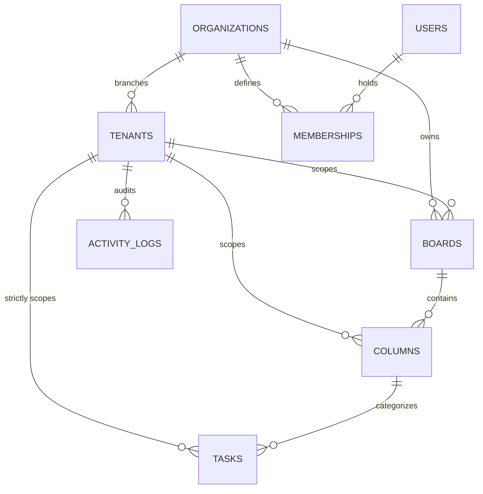

# Real-Time Collaborative Kanban Board
### Multi-Organization & Multi-Tenant Enterprise Task Platform

[](https://nodejs.org/)
[](https://react.dev/)
[](https://socket.io/)
[](https://tailwindcss.com/)
[](#12-testing--verification)

A production-grade, real-time collaborative task management platform where multiple users across parent organizations and independent branch offices (tenants) can collaborate simultaneously with **strict data isolation**, **live WebSocket synchronization**, **optimistic concurrency control (OCC)**, **presence tracking**, **undo/redo**, and an **Agentic AI assistant**.

---

## Table of Contents
1. [Project Overview](#1-project-overview)
2. [Business Problem & Tenancy Model](#2-business-problem--tenancy-model)
3. [Core & Advanced Features](#3-core--advanced-features)
4. [Technology Stack](#4-technology-stack)
5. [System Architecture](#5-system-architecture)
6. [Database Schema & ER Diagram](#6-database-schema--er-diagram)
7. [Strict Tenant Data Isolation](#7-strict-tenant-data-isolation)
8. [Role-Based Access Control (RBAC)](#8-role-based-access-control-rbac)
9. [Real-Time WebSocket Architecture](#9-real-time-websocket-architecture)
10. [Concurrency & Conflict Handling (OCC)](#10-concurrency--conflict-handling-occ)
11. [Installation & Setup Instructions](#11-installation--setup-instructions)
12. [Testing & Verification](#12-testing--verification)
13. [Sample Personas & Seed Credentials](#13-sample-personas--seed-credentials)
14. [Optional Python Agentic AI Service](#14-optional-python-agentic-ai-service)
15. [Trade-offs & Scalability](#15-trade-offs--scalability)
16. [Deliverables Checklist](#16-deliverables-checklist)

---

## 1. Project Overview

Modern enterprise software requires multi-branch coordination without compromising data privacy. This project implements a full-stack, enterprise-grade collaborative task board modeling an organization with multiple independent branches (tenants).

Key differentiators:
- **Zero Cross-Tenant Leakage**: Strict boundary checks at database, REST middleware, controller, and WebSocket room tiers.
- **Low-Latency Collaboration**: Live bidirectional state sync using partitioned Socket.IO channels.
- **Conflict Prevention**: Version-based Optimistic Concurrency Control (OCC) returning `HTTP 409 Conflict` with three-way diff resolution UI.
- **Agentic AI**: Natural language assistant tool resolver analyzing velocities, deadlines, and bottlenecks strictly scoped to the active tenant.

---

## 2. Business Problem & Tenancy Model

Consider a company like **ABC Technologies** with branches in **Hyderabad**, **Bangalore**, and **Chennai**:
- Hyderabad employees work on *Website Development*.
- Bangalore employees work on *CRM Development*.
- Chennai employees manage *Infrastructure*.

### The Hierarchy:
```
Organization: ABC Technologies (Parent Company)
 ├── Tenant 1: Hyderabad Branch
 │    ├── Users: Rahul (Org Admin), Priya (Tenant Admin), Arjun (Member)
 │    ├── Board: Website Development
 │    │    ├── Columns: To Do | In Progress | Testing | Done
 │    │    └── Tasks: [Design Login Page, Develop API, ...]
 │    └── Activity Audit Logs (Isolated to Hyderabad)
 ├── Tenant 2: Bangalore Branch (Strictly isolated from Hyderabad)
 │    ├── Users: Sneha (Tenant Admin)
 │    └── Board: CRM Development
 └── Tenant 3: Chennai Branch

Organization: XYZ Solutions (Completely Isolated Parent Org)
 └── Tenant 1: Mumbai Branch
      └── Users: Kiran (Member)
```

**The Core Isolation Invariant**: Rahul in Hyderabad must never be able to view, edit, or receive real-time socket events for tasks belonging to Bangalore, even if an attacker alters IDs or headers in API requests.

---

## 3. Core & Advanced Features

### Core Requirements
- [x] **CRUD APIs**: Full REST endpoints for Organizations, Tenants, Boards, Columns, and Tasks.
- [x] **Strict Tenancy Hierarchy**: Organization → Tenants → Boards → Columns → Tasks.
- [x] **Tenant-Level Isolation**: Every business entity is bound to a verified `tenant_id`.
- [x] **Three RBAC Roles**: Org Admin, Tenant Admin, Member with server-side enforcement.
- [x] **Real-Time Synchronization**: Live card movements and updates pushed instantly to all collaborators in the same branch.
- [x] **Concurrency Handling**: Atomic moves in transactions and version-based conflict detection.

### Advanced Requirements
- [x] **Branch Presence Indicators**: Live avatars indicating who is currently active in the tenant room.
- [x] **Scoped WebSocket Rooms**: Sockets join `tenant:<tenantId>` rooms only after server-side membership validation.
- [x] **Optimistic UI Updates**: Instant card movement on drag-and-drop with rollback if rejected.
- [x] **Undo / Redo System**: Full undo stack for drag-and-drop task movements (supporting `Ctrl+Z` / `Ctrl+Y`).
- [x] **Live Activity Audit Stream**: Real-time slide-over audit log capturing user actions.
- [x] **3-Way Conflict Resolution**: Interactive UI resolving 409 Conflict (Accept Remote vs Force Overwrite).
- [x] **Network Recovery**: Auto-reconnect with exponential backoff and authoritative board reconciliation.
- [x] **Agentic AI Assistant**: Context-aware tool resolver answering questions regarding overdue tasks, urgent blockers, and branch progress.

---

## 4. Technology Stack

| Tier | Technology | Purpose |
|---|---|---|
| **Frontend** | React 18 + Vite | High-performance SPA with modern React hooks |
| **Styling** | Tailwind CSS + Lucide Icons | Clean, responsive dark-mode enterprise UI |
| **Drag & Drop** | `@hello-pangea/dnd` | Accessible, smooth kanban card movement |
| **Backend Runtime** | Node.js (v20+) + Express.js | Modular REST API and business logic |
| **Real-Time** | Socket.IO | Persistent bidirectional events with scoped rooms |
| **Database** | SQLite (Prisma ORM) / PostgreSQL | Relational storage with foreign keys and transactions |
| **Authentication** | JWT + bcryptjs | Secure password hashing and verified identity |
| **Validation** | Zod | Strict schema validation on all incoming payloads |
| **AI Microservice** | Python 3.11 + FastAPI (Optional) | Context-aware Agentic assistant service |

---

## 5. System Architecture

```
[ React 18 Frontend ] (Port 5173)
   │
   ├─► [ REST API (Express.js) ] (Port 5000)
   │      ├─► Auth Middleware (JWT Verification)
   │      ├─► Tenant Middleware (Strict Membership Check)
   │      ├─► RBAC Middleware (Role Permissions)
   │      ├─► Prisma ORM
   │      │      └─► SQLite / PostgreSQL Database
   │      └─► Optional Forwarding ─► [ Python AI Service (FastAPI) ] (Port 8000)
   │
   └─► [ Socket.IO Server ]
          ├─► Authenticated Handshake (Token)
          ├─► Tenant Room Scoping (tenant:TENANT_ID)
          └─► Presence Map (Online users per branch)
```

---

## 6. Database Schema & ER Diagram

The database features **8 normalized tables**:
1. `organizations` - Parent enterprise entity
2. `tenants` - Branch offices belonging to an organization
3. `users` - Global user accounts
4. `memberships` - Multi-tenant role mappings (user + org + tenant + role)
5. `boards` - Kanban boards scoped by `tenant_id`
6. `columns` - Status columns scoped by `tenant_id`
7. `tasks` - Work items with `version` for Optimistic Concurrency Control
8. `activity_logs` - Audit trail scoped by `tenant_id`

### Interactive Vector Diagram
View the high-resolution vector diagram at [`docs/database-erd.svg`](./docs/database-erd.svg) or markdown specification at [`docs/database-erd.md`](./docs/database-erd.md).



---

## 7. Strict Tenant Data Isolation

We apply defense-in-depth across 4 layers:
1. **Schema Constraints**: Non-nullable `tenant_id` on all business records with composite indexes `[tenant_id, id]`.
2. **`requireTenant` Middleware**: Resolves tenant from `X-Tenant-ID` header; verifies authenticated user has membership in that tenant. Rejects parameter tampering with `403 Forbidden`.
3. **Controller Scoping**: All queries include `{ id: recordId, tenantId: req.tenant.id }`.
4. **WebSocket Room Restrictions**: Users cannot join rooms for branches they do not belong to.

---

## 8. Role-Based Access Control (RBAC)

| Capability | Org Admin | Tenant Admin | Member |
|---|:---:|:---:|:---:|
| Switch across all branches | ✅ | ❌ | ❌ |
| Create new branches | ✅ | ❌ | ❌ |
| Create & delete boards | ✅ | ✅ | ❌ |
| Create & delete columns | ✅ | ✅ | ❌ |
| Create, edit & move tasks | ✅ | ✅ | ✅ |
| Access branch activity audit | ✅ | ✅ | ✅ |
| Query AI Assistant | ✅ | ✅ | ✅ |

---

## 9. Real-Time WebSocket Architecture

- **Handshake**: Authenticates with JWT in `socket.handshake.auth.token`.
- **Partitioned Rooms**: `tenant:<tenantId>`. Events in Hyderabad never reach Bangalore.
- **Presence Management**: Maintains active socket connections per user; broadcasts `presence:update` to room members.
- **Reconnection Recovery**: On disconnect, frontend transitions to "Syncing", retries connection with backoff, re-joins the room, and re-fetches authoritative board state to prevent stale drops.

Full event documentation is available at [`docs/websocket-documentation.md`](./docs/websocket-documentation.md).

---

## 10. Concurrency & Conflict Handling (OCC)

When multiple users collaborate simultaneously:
1. Every task holds an integer `version` field (starts at 1).
2. When User A updates Task 1 from version 1, server increments version to 2.
3. If User B concurrently attempts to save an edit using stale version 1, the backend rejects the write with **HTTP 409 Conflict**:
```json
{
  "success": false,
  "error": "Concurrency Conflict: This task was modified by another user.",
  "serverVersion": 2,
  "clientVersion": 1,
  "currentTask": { ... }
}
```
4. The frontend surfaces an **Optimistic Concurrency Conflict Dialog**, allowing the user to either accept the remote version or force-overwrite with updated version counter.
5. Drag-and-drop reordering is executed inside an atomic database transaction (`prisma.$transaction`) to eliminate sequence gaps.

---

## 11. Installation & Setup Instructions

### Prerequisites
- Node.js v18 or later
- npm v9 or later
- Python 3.10+ (Optional, for Python AI microservice)

### Step 1: Clone & Install Dependencies
```bash
# Clone repository
git clone https://github.com/balakrishna5639/Real-Time-Collaborative-Kanban-Boardreal-time-collaborative-kanban.git
cd real-time-collaborative-kanban

# Install backend dependencies
cd backend
npm install

# Install frontend dependencies
cd ../frontend
npm install
```

### Step 2: Database Setup & Seeding
The backend is pre-configured with Prisma and an SQLite database for instant, zero-friction execution.

```bash
cd backend

# Push schema to database
npx prisma db push

# Seed sample data (2 Organizations, 5 Branches, 5 Personas, 20+ Tasks)
node prisma/seed.js
```

*(Note: A production PostgreSQL DDL schema with Row Level Security is also provided in `database/schema-postgres.sql`)*.

### Step 3: Run the Application
In separate terminal windows:

**Terminal 1 (Backend API & WebSocket Server):**
```bash
cd backend
npm run dev
# Running on http://localhost:5000
```

**Terminal 2 (React Frontend):**
```bash
cd frontend
npm run dev
# Running on http://localhost:5173
```

**Terminal 3 (Optional: Python AI Service):**
```bash
cd ai-service
pip install -r requirements.txt
python main.py
# Running on http://localhost:8000
```
*(If the Python service is not started, the Node.js backend automatically falls back to its built-in agentic tool resolver with 100% feature parity!)*

---

## 12. Testing & Verification

A comprehensive automated test suite is included in `backend/src/tests/run-tests.js` to verify all critical requirements:
- Health check
- User authentication & JWT generation
- Multi-Org and Multi-Tenant scoping
- **Strict Cross-Tenant Isolation** (verifying Arjun in Hyderabad receives 403 on Bangalore)
- **RBAC Enforcement** (verifying Members cannot create boards)
- **Optimistic Concurrency Control (OCC)** (simulating concurrent writes and verifying HTTP 409 Conflict)
- Atomic task movements in transactions
- Activity log recording
- AI Assistant tool execution

### Run Tests:
```bash
cd backend
node src/tests/run-tests.js
```

**Result: 19/19 Passing Tests!**

---

## 13. Sample Personas & Seed Credentials

The login page includes a **1-Click Persona Switcher** for instant evaluator testing.

| Persona | Email | Role | Organization | Branch |
|---|---|---|---|---|
| **Rahul Sharma** | `rahul@abctech.com` | `ORG_ADMIN` | ABC Technologies | Hyderabad |
| **Priya Patel** | `priya@abctech.com` | `TENANT_ADMIN` | ABC Technologies | Hyderabad |
| **Arjun Reddy** | `arjun@abctech.com` | `MEMBER` | ABC Technologies | Hyderabad |
| **Sneha Rao** | `sneha@abctech.com` | `TENANT_ADMIN` | ABC Technologies | Bangalore |
| **Kiran Kumar** | `kiran@xyz.com` | `MEMBER` | XYZ Solutions | Mumbai |

**Password for all demo accounts**: `Password123!`

---

## 14. Optional Python Agentic AI Service

Located in `ai-service/`, this FastAPI microservice acts as an intelligent Kanban Assistant.
- Requires verified `tenantId` forwarded from authenticated backend.
- Agentic tools:
  - `get_board_summary`: Progress metrics and status breakdown
  - `get_overdue_tasks`: Flags tasks exceeding due dates
  - `get_urgent_tasks`: Identifies high-priority blockers
  - `get_activity_logs`: Formulates plain-text audit summaries

---

## 15. Trade-offs & Scalability

### Architectural Trade-offs
1. **Shared Database vs Separate Database**:
   - *Trade-off*: We chose shared database with `tenant_id` scoping to optimize resource usage and enable instant branch onboarding.
   - *Mitigation*: Application-layer middleware guarantees isolation; PostgreSQL RLS policies provided in `database/schema-postgres.sql` can be activated for hardware-level isolation.
2. **Integer Positioning vs Lexorank**:
   - *Trade-off*: Integer positions with transaction shifts ensure deterministic ordering. For millions of tasks, Lexorank strings can eliminate intermediate updates.

### Scaling Strategy
- **Socket.IO Cluster**: Add `@socket.io/redis-adapter` for horizontal scale across multiple server nodes.
- **Read Replicas**: Distribute `GET /api/boards/:id` to PostgreSQL read replicas.

---

## 16. Deliverables Checklist

| Deliverable | Location | Status |
|---|---|:---:|
| **1. Backend & Real-Time Server** | `backend/src/` | ✅ Complete |
| **2. Frontend UI** | `frontend/src/` | ✅ Complete |
| **3. Database Schema & ER Diagram** | `database/schema-postgres.sql`, `docs/database-erd.svg`, `docs/database-erd.md` | ✅ Complete |
| **4. Architecture & Tenancy Model** | `docs/architecture.md`, `README.md` | ✅ Complete |
| **5. REST API Documentation** | `docs/api-documentation.md` | ✅ Complete |
| **6. WebSocket Event Protocol** | `docs/websocket-documentation.md` | ✅ Complete |
| **7. Python Agentic AI Service** | `ai-service/` | ✅ Complete |
| **8. Automated Test Suite** | `backend/src/tests/run-tests.js` (19/19 passing) | ✅ Complete |

