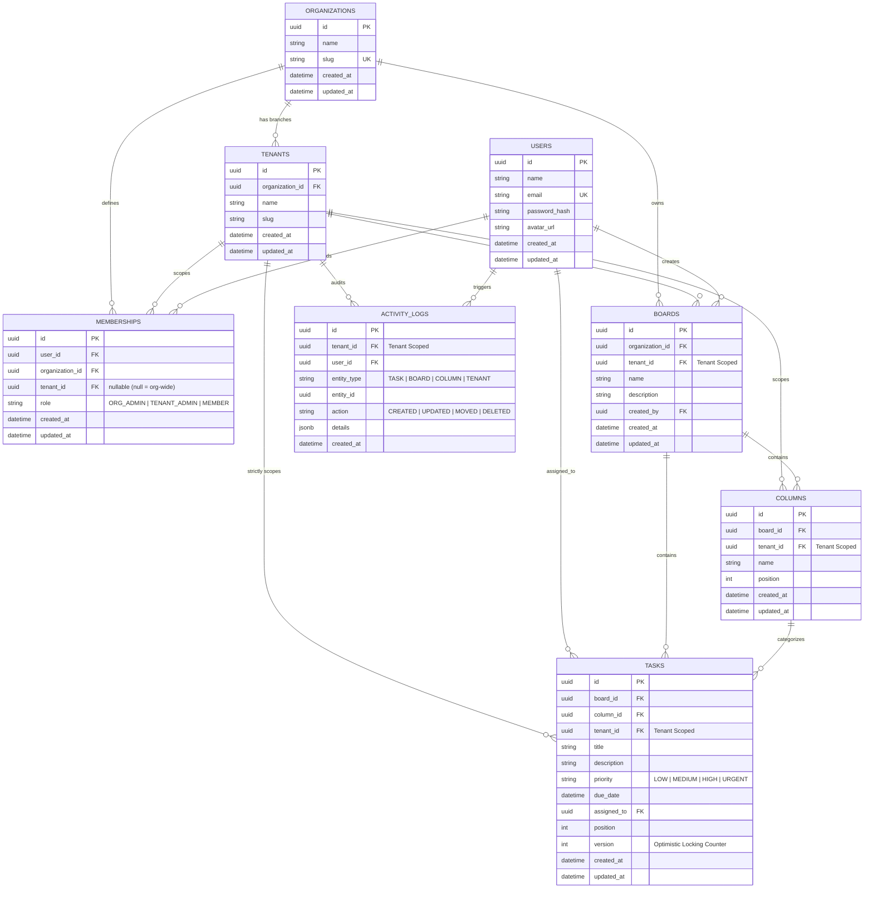

# Database Schema & Entity-Relationship (ER) Documentation

This document describes the 8-table relational schema designed for strict multi-tenant isolation, role-based access control (RBAC), real-time synchronization, and optimistic concurrency control (OCC).

## Entity-Relationship Diagram (Mermaid)

---

## Detailed Table Specifications

### 1. `organizations`
Represents the top-level enterprise entity (e.g. ABC Technologies, XYZ Solutions).
- **id**: Primary Key (UUID)
- **name**: Company name (e.g. "ABC Technologies")
- **slug**: Unique human-readable URL slug (`abc-technologies`)

### 2. `tenants`
Represents branch offices or workspaces belonging to an organization (e.g. Hyderabad, Bangalore, Chennai).
- **id**: Primary Key (UUID)
- **organization_id**: Foreign Key referencing `organizations(id)`
- **name**: Branch name (e.g. "Hyderabad")
- **slug**: Unique per organization (`uq_tenant_org_slug`)

### 3. `users`
Global user identity accounts.
- **id**: Primary Key (UUID)
- **email**: Unique login email
- **password_hash**: Secure bcrypt hashed password
- **avatar_url**: Profile avatar image

### 4. `memberships`
Defines role-based access control (RBAC). A user can have:
1. `ORG_ADMIN`: Universal administrator across all branches when `tenant_id` is null.
2. `TENANT_ADMIN`: Administrator for a specific branch (manages boards, columns, members).
3. `MEMBER`: Regular collaborator within a specific branch (creates, moves, and edits tasks).

### 5. `boards`
Kanban board workspace scoped to a specific tenant.
- **tenant_id**: Enforces that only authorized tenant members can view or mutate this board.
- **created_by**: References user who created the board.

### 6. `columns`
Workflow stages (e.g. To Do, In Progress, Testing, Done).
- **tenant_id**: Scoped to branch to guarantee no cross-branch leaks.
- **position**: Zero-indexed integer for horizontal ordering.

### 7. `tasks`
Individual work items on the board.
- **tenant_id**: Critical isolation field. Every task lookup requires `WHERE id = ? AND tenant_id = ?`.
- **priority**: `LOW`, `MEDIUM`, `HIGH`, `URGENT`.
- **version**: Integer incremented on each mutation to prevent stale overwrites (Optimistic Concurrency Control).
- **position**: Ordering index within its parent column.

### 8. `activity_logs`
Comprehensive audit trail and live event feed scoped strictly to the tenant.
- **tenant_id**: Prevents audit log cross-contamination between branches.
- **details**: JSON structure storing before/after diffs, titles, and movement directions.

---

## Database Indexing Strategy
To guarantee fast sub-millisecond queries under heavy concurrent collaboration:
- `idx_tasks_tenant_board` (`tasks(tenant_id, board_id)`)
- `idx_tasks_column_position` (`tasks(column_id, position)`)
- `idx_activity_logs_tenant_time` (`activity_logs(tenant_id, created_at DESC)`)
- Foreign key indexes on all relation fields.

